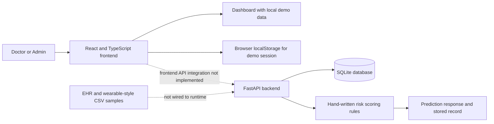

# TwinCare AI

### AI-Powered Healthcare Digital Twin for Predictive Health Monitoring

TwinCare AI is a healthcare Digital Twin proof-of-concept that presents synthetic EHR and wearable-style measurements in a clinician dashboard. The repository contains a React demonstration frontend and a separate FastAPI prototype with a SQLite database and a hand-written, threshold-based risk scoring endpoint. The frontend currently uses local sample data and is not connected to the API.

## Team Details

- Team Name: Not provided
- Team Leader: Not provided
- Team Members: Not provided
- Team Leader Contact: Not provided
- Team Email: Not provided
- Team ID: Not provided

## College / Incubator Information

- College / University: Not provided
- Incubator: Not provided
- City: Not provided
- State: Not provided
- Country: Not provided

## Public Links

- GitHub Repository: https://github.com/nagvadiyabrij/TWINCARE-AI (public access is not verified; GitHub currently returns 404)
- Live Website: [Open TwinCare AI](https://nagvadiyabrij.github.io/TWINCARE-AI/) (planned URL; deployment is pending)
- Admin Panel: https://nagvadiyabrij.github.io/TWINCARE-AI/#/admin (available after deployment; demo login required)
- Demo Video: Not provided
- Public API: Not deployed; local API documentation is at http://localhost:8000/docs after starting the backend

## Project Title

TwinCare AI: AI-Powered Healthcare Digital Twin for Predictive Health Monitoring.

The prototype demonstrates a unified patient view using bundled sample EHR and wearable-style data. Its dashboard and backend predictor are separate components; the dashboard does not currently retrieve data from the API.

## Problem Statement

Healthcare information is distributed across records, lab results, and monitoring devices. Clinicians need a coherent view of historical and current measurements to review patient trends and identify signals that may warrant proactive monitoring. TwinCare AI illustrates this workflow with synthetic sample data and a demonstration dashboard. It is not a deployed clinical monitoring system and does not establish that its predictions prevent adverse events.

## Healthcare Use Case

The demonstration represents a clinician reviewing a synthetic patient record, wearable-style measurements, risk indicators, alerts, and a simple prediction. The backend endpoint applies rules to estimate a glucose-related risk pattern; it is not trained on clinical data. The dashboard's numbers and charts are local demonstration content.

```text
Patient
	-> Historical EHR-style sample data
	-> Wearable-style sample measurements
	-> Data fusion (demonstrated concept; not an automated frontend pipeline)
	-> Digital Twin-style patient view
	-> Rule-based prediction endpoint (separate backend prototype)
	-> Risk indicator
	-> Doctor dashboard
```

## Features

- Doctor dashboard with bundled synthetic patient examples
- Patient list, patient selection, and risk indicators in the demo UI
- Digital Twin-style patient visualization
- Static wearable-style readings and trend charts; no live device stream
- Demo alerts, prediction cards, and report views
- Local demo sign-in for Doctor and Admin roles
- Separate FastAPI prototype with authentication, patient, twin, alert, report, settings, and prediction routes
- SQLite persistence and sample records in the backend
- GitHub Actions workflow prepared for frontend GitHub Pages deployment; not yet published

The frontend sign-in uses local browser state and does not authenticate against the backend. The Admin dashboard is a prototype UI, not a complete administration product. Audit logs, PostgreSQL, production EHR/wearable integration, and public API hosting are not implemented.

## System Architecture

The current implementation consists of two separate paths. The static frontend displays local fixture data; the backend API independently stores seeded sample records in SQLite. The CSV files are included as sample data, but no automated CSV ingestion or frontend-to-backend connection is implemented.



See [the architecture notes](docs/architecture/README.md). A PDF or PowerPoint architecture deliverable has not been created.

## Technical Stack

### Frontend

- React, TypeScript, Vite
- Tailwind CSS, Recharts, Lucide React
- Axios is a dependency but is not currently used to connect the dashboard to the API

### Backend

- Python, FastAPI, Uvicorn
- SQLAlchemy, Pydantic, PyJWT
- REST-style JSON endpoints

### Database

- SQLite file at `database/twincare.db`, created by the backend at startup
- PostgreSQL is not configured in the current implementation

### AI/ML

- Python rule-based scoring function
- No ML package is required for the current prediction endpoint; it does not train or load a model

### Development

- Git, GitHub Actions, Node.js/npm, and Python
- VS Code or another compatible editor

## AI/ML Model

- Model Name: TwinCare weighted risk rules (backend implementation)
- Model Type: Hand-written threshold and weighted score; not a trained machine-learning model
- Framework: Python; no ML framework is used by the scoring function
- Input Features: Glucose, heart rate, HRV, sleep duration, steps, activity label, and HbA1c
- Output: Low or Moderate risk level, text prediction, heuristic confidence value, two-hour horizon, and up to four contributing factors
- Prediction Horizon: Fixed at two hours
- Training Data: None; no model training occurs. Bundled CSV files are sample data and are not used to fit this predictor
- Evaluation Metrics: None reported; the heuristic has not been clinically or statistically validated
- Model Version: `v2.4` is returned for stored prediction records

The score adds fixed weights when feature thresholds are crossed. A score below `0.5` returns Low; a score at or above `0.5` returns Moderate. The confidence value is a formula output, not a calibrated probability. Blood pressure is present in a schema/sample CSV but is not used by the prediction endpoint. The endpoint does not produce a High risk result.

## Data Privacy

The repository describes the bundled CSV data as synthetic. Those files contain patient-like names and health attributes, so maintainers must confirm their provenance is fully fictitious before making the repository public. Do not commit real patient information, `.env` files, database passwords, API keys, JWT secrets, private credentials, or private certificates. The backend currently has a development JWT fallback secret; do not use it for a public production service.

## Demo Video

Demo Video: Not provided. No public or unlisted 15-20 minute video link was supplied. The presentation notes include a suggested walkthrough, but this requirement remains incomplete.

## Demo Credentials

These demo credentials are hard-coded in the frontend prototype and also seeded by the backend on an empty SQLite database. Change/remove them before any production deployment.

| Role | Email | Password |
| --- | --- | --- |
| Doctor | `doctor@twincare.ai` | `Demo@123` |
| Admin | `admin@twincare.ai` | `Admin@123` |

## API

Start the backend locally to use these endpoints. Most data endpoints require a Bearer token returned by `POST /api/auth/login`; `GET /api/health` and `POST /api/predict` do not require one in the current code.

| Method | Path | Purpose |
| --- | --- | --- |
| GET | `/api/health` | Health status |
| POST | `/api/auth/login` | Issue a demo JWT |
| GET | `/api/me` | Current user |
| GET | `/api/admin/overview` | Admin summary |
| GET | `/api/users` | User list (Admin role) |
| GET | `/api/patients` | Patient list |
| GET | `/api/digital-twins` | Digital Twin records |
| GET | `/api/alerts` | Alert records |
| GET | `/api/reports` | Prediction/report records |
| GET | `/api/settings` | Demo settings |
| POST | `/api/predict` | Rule-based risk estimate and stored prediction |

## Installation

The repository URL below is not publicly accessible at the time of writing. Clone it after the owner makes the repository public, or use an available local copy.

### 1. Clone the Repository

```bash
git clone https://github.com/nagvadiyabrij/TWINCARE-AI.git
cd TWINCARE-AI
```

### 2. Install and Run the Frontend

```bash
cd frontend
npm ci
npm run dev
```

Open the Vite URL shown in the terminal. The current frontend is a standalone mock/demo and does not require the API to render.

### 3. Install and Run the Backend

In a second terminal from the repository root:

```bash
python -m venv backend/.venv
```

Windows PowerShell:

```powershell
backend\.venv\Scripts\Activate.ps1
python -m pip install -r requirements.txt
Set-Location backend
python -m uvicorn app.main:app --reload --host 127.0.0.1 --port 8000
```

macOS/Linux:

```bash
source backend/.venv/bin/activate
python -m pip install -r requirements.txt
cd backend
python -m uvicorn app.main:app --reload --host 127.0.0.1 --port 8000
```

The API docs are available at http://localhost:8000/docs. The backend creates a local SQLite database and seeds demo users/records when the database is empty. No PostgreSQL setup is required by this code.

## System Architecture Deliverable

Architecture source notes and a Mermaid diagram are in [docs/architecture/README.md](docs/architecture/README.md). The requested `TwinCare_AI_Architecture.pdf` or `.pptx` is not present yet.

## Presentation

The planned slide outline is in [docs/presentation/README.md](docs/presentation/README.md). The requested presentation PDF/PPTX is not present yet; team, institution, video, and deployment details are also pending.

The project report source is [docs/reports/project-report.md](docs/reports/project-report.md); the requested `project-report.pdf` has not been generated.

## Outcomes

The prototype demonstrates a patient dashboard concept and a separate API that stores synthetic demo records and applies simple feature thresholds to produce an illustrative risk response. It does not demonstrate a connected, real-time, clinically validated Digital Twin system.

## Limitations

- The UI uses local static data and is not connected to the FastAPI service.
- Wearable values and dashboard trends are simulated/static; there is no live device stream.
- The prediction endpoint is a simple, unvalidated rule set, not a trained or clinically validated model.
- The backend uses SQLite only; PostgreSQL is not configured.
- Authentication, password hashing, and the default JWT secret are demonstration-grade and not production-secure.
- No public backend/API deployment is available.
- Real-world use would require verified data governance, security review, clinical validation, and applicable regulatory/compliance work.

## Future Scope

- Connect the frontend to the backend using a configured API base URL
- Add verified EHR and wearable integrations and real-time ingestion
- Move to a managed database with migrations and secure secret management
- Improve authentication, password hashing, role enforcement, and auditability
- Develop and independently evaluate an explainable model using authorized datasets
- Add clinical validation, reporting exports, and a mobile companion

## License

This project is released under the MIT License. See [LICENSE](LICENSE) for the full text.

## Submission Checklist

- [x] Project title, problem statement, and healthcare use case documented
- [x] Actual technical stack and current rule-based predictor documented
- [x] Installation instructions and local demo credentials documented
- [x] MIT license included
- [x] Current architecture described with a Mermaid diagram
- [x] Project report source drafted in Markdown
- [ ] Team details and Team ID supplied
- [ ] College / incubator information supplied
- [ ] 15-20 minute public/unlisted demo video added
- [ ] Architecture PDF/PPTX created and uploaded
- [ ] Presentation PDF/PPTX created and uploaded
- [ ] Project report PDF created and uploaded
- [ ] Dataset provenance confirmed and public-data privacy audit completed
- [ ] GitHub repository verified public and accessible without permission
- [ ] Live website deployed and verified
- [ ] Admin panel public link verified
- [ ] API deployed and verified
- [ ] All final submission resources publicly accessible

## Prototype Notice

TwinCare AI is a research and demonstration prototype. Its outputs are not medical advice, diagnosis, or treatment recommendations and must not be used for clinical decisions.
