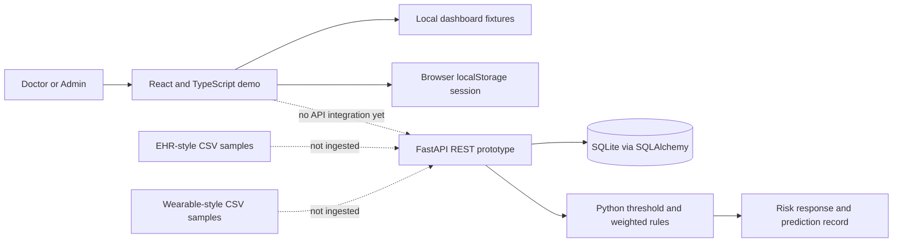

# TwinCare AI Architecture

This diagram describes the current prototype, not a deployed integrated clinical system. The React demo uses local fixture data; the FastAPI service is separate and persists records in SQLite. The CSV files are not currently ingested by either runtime path.

The predictor currently considers glucose, heart rate, HRV, sleep, steps, activity, and HbA1c. It returns Low or Moderate risk, a heuristic confidence value, a fixed two-hour horizon, and contributing factors. No trained model, real-time streaming, PostgreSQL service, or architecture PDF is included.

The PDF/PPTX architecture deliverable required for submission has not yet been generated.
